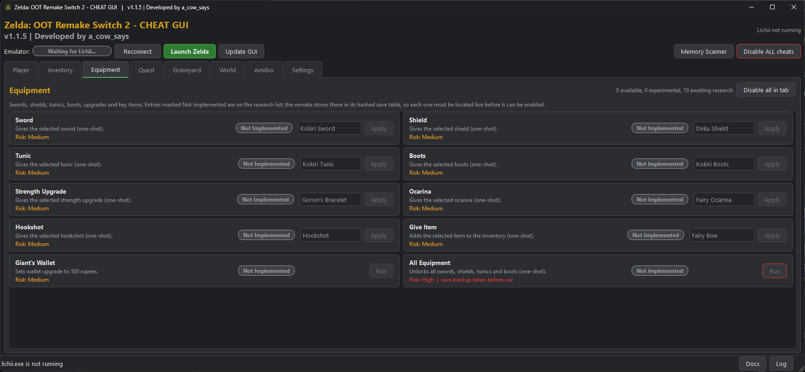
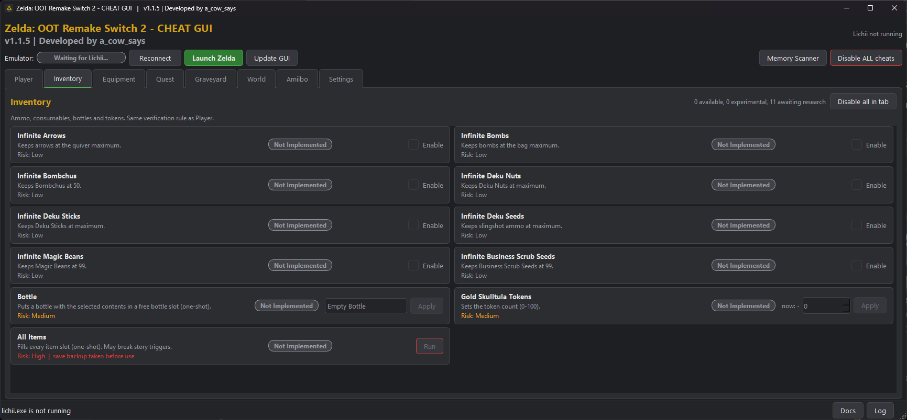
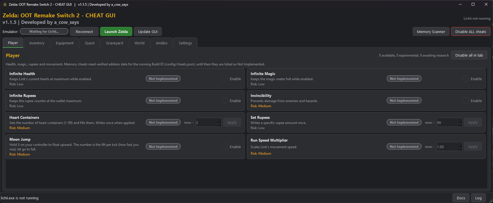
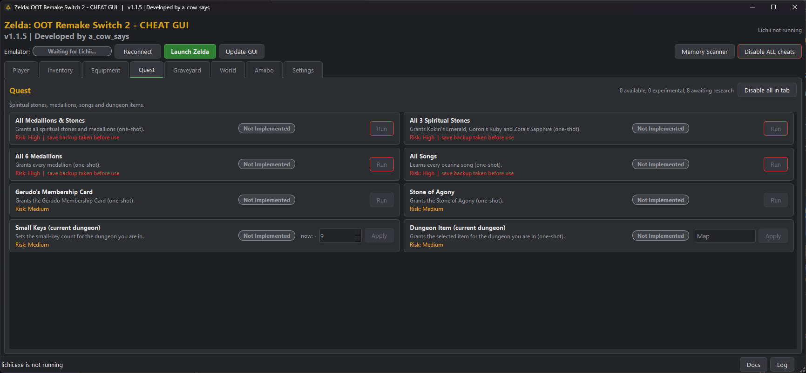

# Zelda OOT Remake Switch 2 — Cheat GUI

An ongoing project to develop a user-friendly Cheat GUI for Zelda OOT Remake on Switch 2 emulators.

The project is actively being updated with new features, bug fixes, and emulator compatibility improvements. User experience may vary depending on the emulator and game version.

## Downloads & Resources

- **[Download the Latest Release](https://github.com/invalid8080-dotcom/Zelda-OOT-Remake-Switch-2---Cheat-GUI/releases)**
- **[Report Bugs & Request Features](https://github.com/invalid8080-dotcom/Zelda-OOT-Remake-Switch-2---Cheat-GUI/issues)**
- **[Shader Dump Releases](https://github.com/invalid8080-dotcom/zelda-OOT-Remake-switch-2-shader-dump/releases)**
- **[Compatible Amiibos](https://github.com/invalid8080-dotcom/Zelda-OOT-Remake-Switch-2---compatable-amiibos)**

## ▶️ Setup Guide — v1.1.5

The updated tutorial covers the new emulator profile system, automatic emulator detection, and setting up the Cheat GUI for the first time.

**What's new in v1.1.5:**
- Automatic emulator profile population for easier setup.
- Detect and select installed emulator forks.
- One-click emulator relaunch with cheats connected.
- Automatic emulator shutdown and restart.
- Per-emulator settings and configuration management.
- Existing settings automatically migrated into emulator profiles.

**Important:** Pressing **Launch Zelda** will close and relaunch an emulator that's already running. Save your game first to avoid losing unsaved progress.

**[▶ Watch the v1.1.5 Setup Guide on YouTube](https://www.youtube.com/watch?v=42SasTDRDyU)**

## GUI Screenshots

A look at the Cheat GUI and its available features.

## Support the Project

This project takes time to develop, research, test, and maintain. That's time I could be spending earning money elsewhere.

If you find the Cheat GUI useful and want to support its continued development, you can help out here:

**[Support Cow on PayPal](https://www.paypal.com/paypalme/cowslink)**

Thanks to everyone using the GUI, reporting bugs, and helping improve the project.

— **a_cow_says**
